<picture>
  <source media="(prefers-color-scheme: dark)" srcset="docs/readme/assets/hero-dark.svg">
  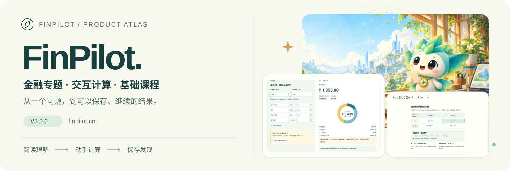
</picture>

<p align="center">
  <a href="https://finpilot.cn"><strong>Live Website · 在线体验</strong></a> ·
  <a href="#five-spaces">Explore Features · 五大页面</a> ·
  <a href="docs/INDEX.md">Documentation · 文档</a> ·
  <a href="https://github.com/zxy6688/FinPilot/releases/tag/v3.0.0">Latest Release · v3.0.0</a>
</p>
<p align="center">
  <a href="https://github.com/zxy6688/FinPilot/actions/workflows/ci.yml"></a>
  <br>
  React 19 · TypeScript · FastAPI · SQLite · Three.js
</p>
<p align="center"><a href="docs/README.en.md">English guide</a> · <a href="#architecture">Architecture</a> · <a href="#run-locally">Run locally</a> · <a href="#production">Production</a></p>

**面向大学生与金融初学者的金融学习与实验平台。** 从生活费、存钱、购买力、基金或贷款的问题开始，阅读解释、操作模型、检验理解，再把结果保存下来继续使用。

FinPilot connects financial reading, deterministic calculations and structured learning with a personal record of what you explored. **Education, not personalized investment advice.**

[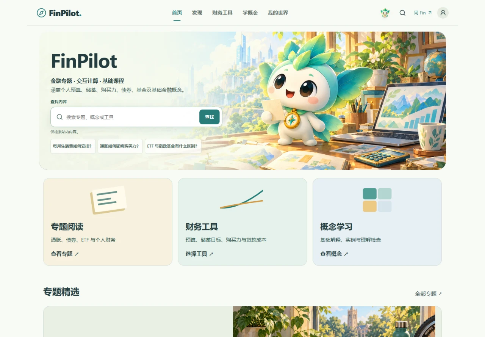](https://finpilot.cn)

<sub>真实生产截图 · 2026-11-10 · v3.0.0 / ab4a29c · 仅访客教学数据。封面为原创编辑式组合图，不是网页截图。[素材与拍摄记录](docs/readme/ASSETS.md)</sub>

| 读懂一个问题 | 亲手改变条件 | 建立知识联系 | 留下可恢复的结果 |
| :--- | :--- | :--- | :--- |
| **5** 篇原创互动专题 | **5** 套财务工作台 | **6** 领域 · **36** 概念 | 笔记、阅读成果、实验小票 |
| 案例、机制与理解检查 | 确定性公式与情景对比 | **28** 课程 · **64** 原题 | 访客本地 / 登录账户隔离 |

还有 **5 条学习路线、8 个原有教学实验**。[数字来自真实内容清单](docs/repository/REPO_AUDIT_2026-11-10.md#内容覆盖)，不是使用量或学习成效统计。

## Experience

“ETF 与指数基金有什么区别？”不必先知道该去哪个页面。首页先列出已有内容；选中概念后，看分类、切换案例、答题、写下理解，再从我的世界重新打开。

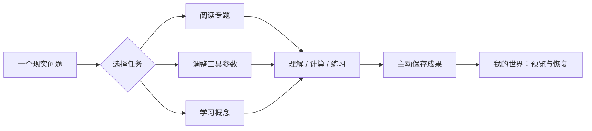

## Five Spaces

### 01 / Home — 找到要完成的事

[打开首页 →](https://finpilot.cn/)

查找站内内容，选择专题、工具或概念；已有记录时，继续一条真实可恢复的任务。输入问题后在当前页显示至多三条候选，**不会假装生成 AI 答案或自动替你跳转**。

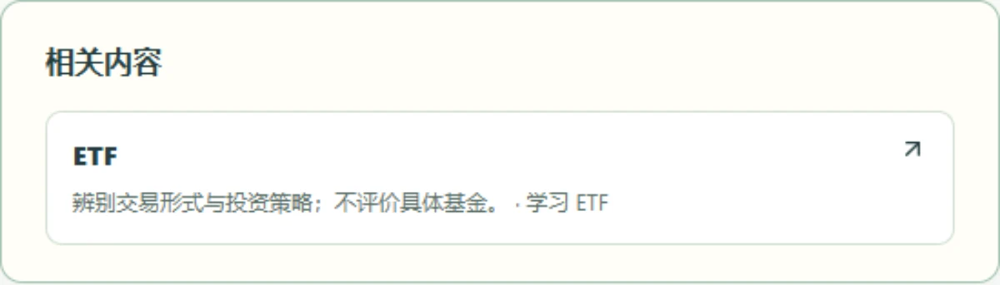

<sub>代表性交互：查找“ETF 与指数基金有什么区别”，再由用户选择已有概念内容。</sub>

### 02 / Discover — 读一篇能动手的专题

<table>
<tr>
<td width="36%" valign="top">
<strong>从案例到机制，再到自己的解释。</strong><br><br>
五篇原创专题采用编辑式阅读版面，穿插小实验、理解检查和资料来源。这里不是行情终端，也不是实时新闻流。<br><br>
<a href="https://finpilot.cn/discover">浏览五篇专题 →</a>
</td>
<td width="64%"></td>
</tr>
</table>

| 专题 | 实际可以探索什么 |
| :--- | :--- |
| [大学生的第一份预算](https://finpilot.cn/stories/budget) | 在 2,500 元生活费的教学情景里，加入 600 元维修费，比较结余与储备缺口。 |
| [存钱与购买力](https://finpilot.cn/decoder/purchasing-power) | 调整通胀假设，看名义金额与折算购买力的差别。 |
| [降息与债券](https://finpilot.cn/stories/bonds) | 区分政策利率、市场收益率与价格，观察条件变化；不把降息等同于必然上涨。 |
| [ETF 究竟是什么](https://finpilot.cn/stories/etf) | 理解交易机制、净值与价格、费用和风险；完整分类练习可进入概念页。 |
| [贷款到底还多少](https://finpilot.cn/stories/loan) | 把借款面额、扣费后净到账和之后的还款现金流分开理解。 |

专题中的数字是明确的教学假设。ECB、CFPB、Investor.gov 等是引用资料来源，不是项目背书。完整参数工作台留在 Money Lab，阅读页聚焦理解与保存发现。

### 03 / Money Lab — 算清楚，也看懂差别

[进入财务工具 →](https://finpilot.cn/money-lab)

输入条件，查看结果与图表，固定情景 A，再试算 B。计算由确定性后端模型完成；保存的小票包含参数，可以重新打开继续比较。

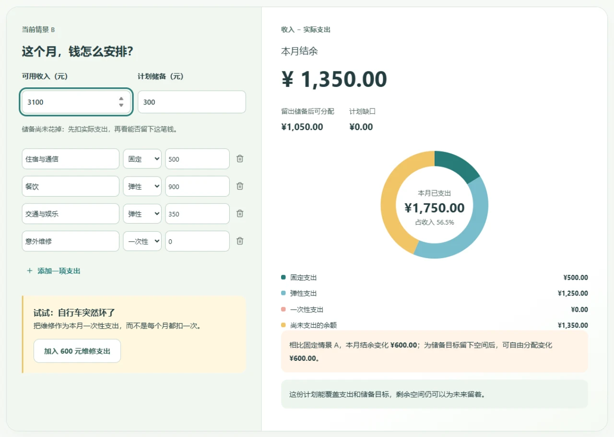

| 工作台 | 输入与结果 | 必须知道的边界 |
| :--- | :--- | :--- |
| [个人预算](https://finpilot.cn/money-lab/budget) | 可用资金、固定/弹性/一次性支出、储备目标 → 结余、缺口、结构图 | 输入是情景计划，不代表已发生的实际支出。 |
| [储蓄规划](https://finpilot.cn/money-lab/savings) | 本金、月存、期限、利率 → 终值或达成目标所需月存 | 区分月初/月末投入与利率口径；不保证未来收益。 |
| [购买力](https://finpilot.cn/money-lab/inflation) | 金额、年数、通胀和金额增长率 → 名义金额、实际购买力 | 假设实验，不是未来通胀预测。 |
| [贷款成本](https://finpilot.cn/money-lab/loan) | 还款方式、利率、期限、期初和每月费用 → 净到账、还款与有效成本 | 模型有效年成本不冒充监管定义的 APR。 |
| [复利计算](https://finpilot.cn/money-lab/compound) | 单笔本金、期限、计息次数、名义/有效收益率 → 时间价值 | 单笔复利与持续追加的储蓄规划是不同任务。 |

<details>
<summary>查看真实工具目录与八个进阶教学实验入口</summary>


原八个教学实验保留在目录的进阶入口。模型口径与适用范围见[计算方法](docs/redesign/GATE_B_TOOL_FORMULAS.md)。

</details>

### 04 / Concept Studio — 自由查概念，或沿课程学习

<table>
<tr>
<td width="64%"></td>
<td width="36%" valign="top">
<strong>把零散的问题连接成知识。</strong><br><br>
按领域、关键词查找概念，或选择课程路线。概念页结合定义、生活案例、误解、微实验与解释型练习。<br><br>
<a href="https://finpilot.cn/concept-studio">知识索引 →</a><br>
<a href="https://finpilot.cn/concept-studio?mode=courses">课程路线 →</a>
</td>
</tr>
</table>

六个领域覆盖金钱基础、个人财务、投资产品、宏观经济、市场运作和金融行为。**浏览过、即时答题与正式复习是不同证据，不把一次答对叫作“已经掌握”。**

[ETF 概念页](https://finpilot.cn/concept-studio/7)把“交易形式”和“投资策略”放进可点击的二维矩阵。指数 ETF、主动 ETF、场外指数基金等各有案例；错误选项获得针对性反馈，笔记与互动状态可以保存恢复。

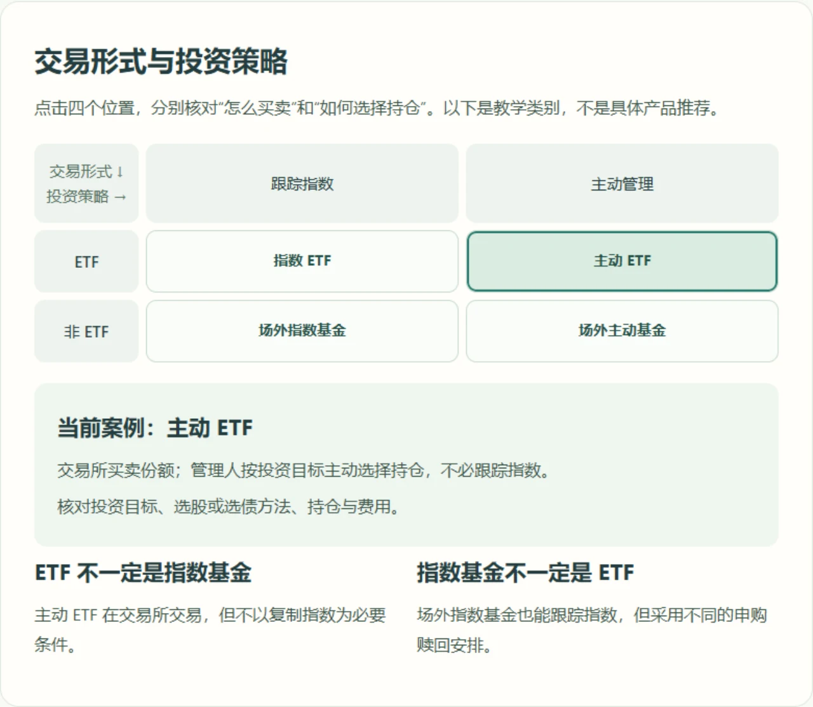

<sub>36 个概念中，27 道即时题关联原题 ID，可显式提交到正式复习；其余 9 道不冒充已入库的复习题。旧课程、路线和 ETF 链接继续兼容。</sub>

### 05 / My World — 找回结果，继续使用

[打开我的世界 →](https://finpilot.cn/profile)

搜索、筛选、排序保存过的内容，原地预览结果与参数；需要修改时，再恢复到对应工作台。笔记可以改名，记录可以删除，学习历史、收藏、复习和 Fin 纪念册也有各自入口。

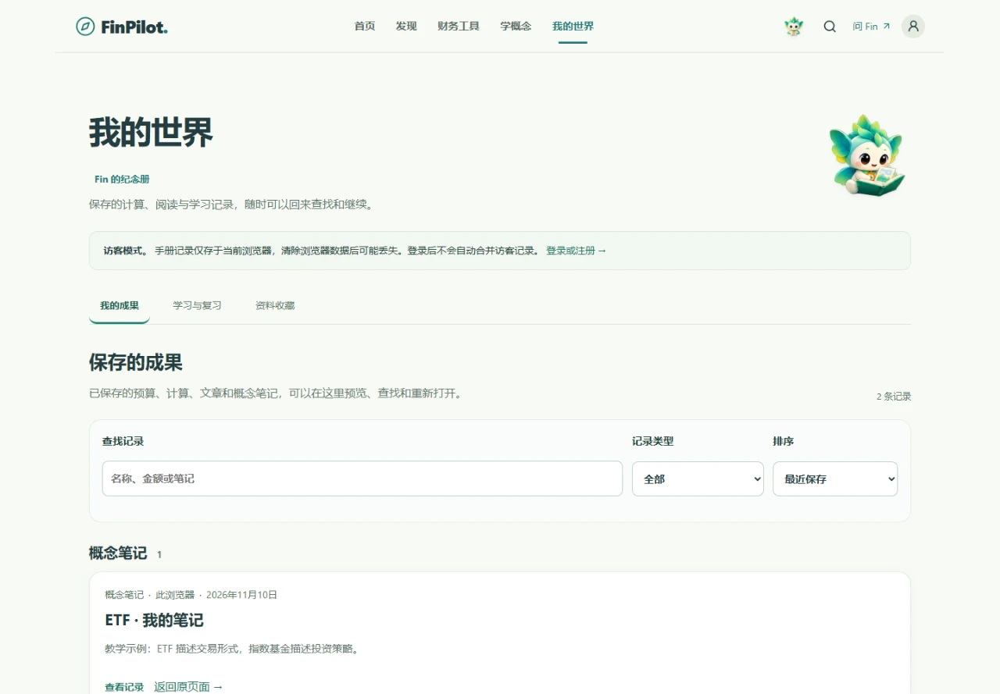

<details>
<summary>一张可重新打开的小票，而不是只有标题的收藏卡</summary>

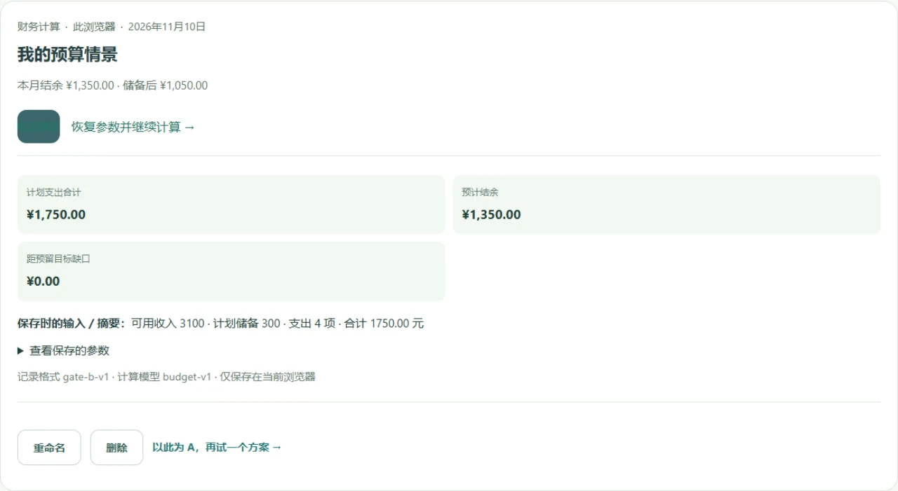

访客保存仅限当前浏览器；登录后主动保存到账户的记录可在同一服务的其他设备重新登录恢复。浏览器历史记录不会自动上传，也没有凭空产生的“掌握率”。旧入口 `/profile/history` 仍保留。

</details>

<p align="center">
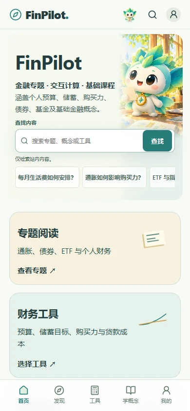
&nbsp;&nbsp;
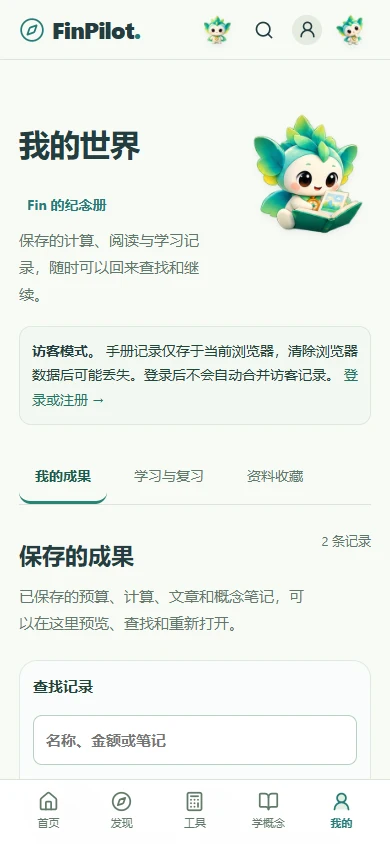
</p>

<sub>同一产品的手机布局实拍，390 CSS px 浏览器模拟；不等同实体手机性能认证。</sub>

## Meet Fin

**Fin 是陪伴这五个空间的角色，不是另一套产品导航。**

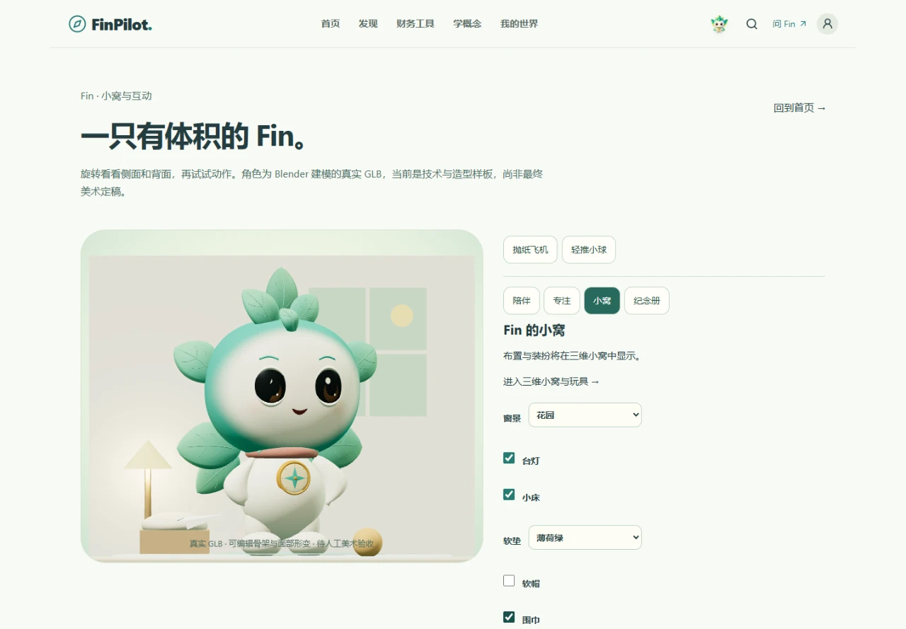

常驻或隐藏、拖动与触摸、姿态动画；120 条规则脚本带冷却与防重复。主动选择心情、安静陪伴、专注计时、小窝、配饰、玩具和纪念册均有实际交互。学习、计算与保存反馈来自真实业务事件，基础功能不依赖付费 AI。

**专业美术尚未验收通过。** 当前 GLB 仍为程序化候选，脸部、肩部、叶片、服饰贴合与动作仍需专业改善；玩具不是完整刚体碰撞系统。实体手机温度和功耗尚未验证。FinChat 当前使用明确标识的 **AI Demo**，不宣称联网金融顾问能力。

[实际 Fin 页面](https://finpilot.cn/fin-pet) · [GLB 与可编辑工程的资产说明](docs/release/ASSETS.md) · [v3.0.0 美术审查附件](https://github.com/zxy6688/FinPilot/releases/tag/v3.0.0)

## Architecture

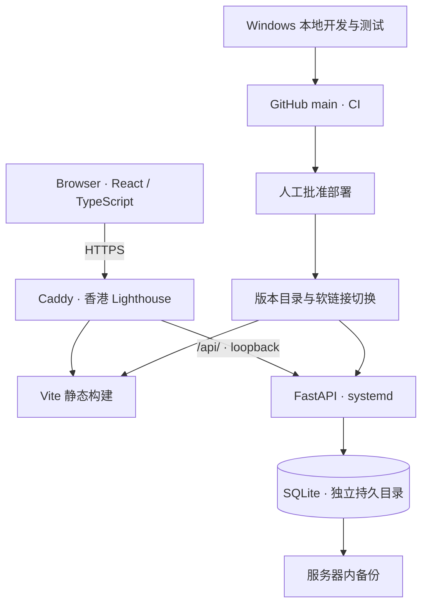

架构示意；真实路径和服务见[生产状态](docs/deployment/PRODUCTION_STATUS.md)。前端在本地构建，服务器不承担 Node 构建负担。

| 层 | 当前实现 |
| :--- | :--- |
| 界面与图表 | React 19、TypeScript 5.7、Vite 6、React Router、Recharts |
| 计算与数据 | FastAPI、Pydantic、SQLAlchemy、SQLite WAL；确定性金融模型 |
| 角色 | Three.js / React Three Fiber、真实 GLB、独立保留的 Blender 工程 |
| 发布 | Caddy HTTPS、systemd、按提交保存的发布目录、独立数据库 |
| 校验 | pytest、TypeScript / build、Playwright 脚本、GitHub Actions |

```text
backend/app/               API、计算模型、账户、增量内容初始化
backend/tests/             数学边界、权限、保存恢复与兼容性测试
content/                   概念、课程、题目、专题及初始化数据
frontend/src/redesign/     五大页面与概念/工具/专题
frontend/src/living/       阅读、复习、路线等仍在使用的深层体验
frontend/src/fin-pet/      常驻交互、状态机、脚本、3D 场景
frontend/public/           现有品牌素材与正式运行 GLB
scripts/                   本地启动、检查、发布和美术工具
deploy/production/         Caddy、systemd、备份与版本激活
docs/                      产品依据、工程文档、验收与仓库审计
```

[完整路径与职责盘点](docs/repository/REPO_AUDIT_2026-11-10.md) · [版本沿革](docs/repository/VERSION_HISTORY.md) · [文档目录](docs/INDEX.md)

## Run Locally

已验证 Windows 开发环境：**Node 24.18.0、Python 3.13.2**；香港生产后端为 **Python 3.12.3 / Ubuntu 24.04.4 LTS**。建议使用上述开发组合；锁定依赖分别在 `frontend/package-lock.json` 和 `backend/requirements.lock.txt`。

```powershell
git clone https://github.com/zxy6688/FinPilot.git
cd FinPilot
powershell -NoProfile -ExecutionPolicy Bypass -File scripts/Setup-FinPilot.ps1
powershell -NoProfile -ExecutionPolicy Bypass -File scripts/Start-FinPilot.ps1
```

脚本打印实际状态并打开 `http://127.0.0.1:5176/`，API 默认 `http://127.0.0.1:8004/api/health`；端口被其他进程占用时明确报错，不终止它们。本地数据与日志留在项目内。

<details>
<summary>停止、测试、环境变量与 Linux/macOS 手动启动</summary>

```powershell
powershell -NoProfile -ExecutionPolicy Bypass -File scripts/Stop-FinPilot.ps1
powershell -NoProfile -ExecutionPolicy Bypass -File scripts/Check.ps1
node scripts/test-pet-director.mjs
node scripts/test-fin-scripts.mjs
```

`.env.example` 提供不含凭据的模板。开发可使用自动生成的本地 JWT 密钥；生产须显式提供至少 32 字符随机密钥，否则拒绝启动。

```dotenv
DATABASE_URL=sqlite:///data/finpilot.db
FINPILOT_ENV=development
JWT_SECRET=
FINPILOT_ALLOW_SHARED_DEMO=false
CORS_ORIGINS=http://localhost:5176,http://127.0.0.1:5176
LLM_API_KEY=
LLM_MODEL=
```

手动启动（两个终端）：

```bash
python3 -m venv .venv
. .venv/bin/activate
pip install -r backend/requirements.lock.txt
mkdir -p data logs tmp
cp .env.example .env
PYTHONPATH=backend python -m app.seed
PYTHONPATH=backend uvicorn app.main:app --host 127.0.0.1 --port 8004
# 第二个终端
cd frontend
npm ci
npm run dev
```

单独构建：在 `frontend/` 执行 `npm run typecheck`、`npm run build`。后端测试从仓库根目录执行 `python -m pytest backend/tests -q`，测试数据库只在 `tmp/`。不要对生产库执行测试 fixture 或重置脚本。

本地脚本可显式启用共享演示；生产禁用共享账户，请注册独立账户。README 不公布共享登录凭据。

</details>

**验证有边界。** v3.0.0 的独立克隆安装、165 项后端测试、TypeScript / build 和 Linux CI 通过；线上另行验证了注册登录、数据隔离、保存恢复、页面与 Fin、备份恢复和程序回滚。[发布及线上验证记录](docs/release/VALIDATION.md) · [本次文档检查](docs/readme/VALIDATION.md)

## Production

**已上线：[finpilot.cn](https://finpilot.cn)。** 腾讯云香港 Lighthouse，DNSPod 解析，Caddy 自动管理 HTTPS；`www` 跳转根域。生产数据库、密钥和版本目录分离。

```text
本地修改 → 测试 → GitHub main → CI 通过 → 人工批准 → 生产部署
```

日常推送只触发 CI，不自动发布。已配置本机维护环境的项目维护者使用：

```powershell
powershell -NoProfile -ExecutionPolicy Bypass `
  -File "D:\finpilot开发\Publish-FinPilot.ps1" `
  -Mode Deploy -ApproveProduction
```

这份包装脚本在维护者机器上，**不随仓库克隆自动获得**；它设置生产构建开关，调用仓库内 `scripts/Release-Production.ps1`。其他机器须先配置自己的 SSH、服务器和环境，参见[运维说明](docs/deployment/PRODUCTION.md)。

生产数据位于 `/var/lib/finpilot`；备份位于 `/var/backups/finpilot`。已在服务器临时隔离实例中验证备份可恢复并执行业务；也已完成前一兼容 V3 提交与正式版本之间的程序回滚演练，未替换生产数据库。

**当前仅有服务器内备份，没有异地灾备。** 程序回滚不能代替数据库恢复；不兼容迁移需要单独方案。

## History & Transparency

| 阶段 | 可核验的 Git 证据 |
| :--- | :--- |
| V1 基础版本 | `240914e` 发布提交；旧 main 后续停在 `97908aa`，由 `backup/main-before-v3-20261110` 保留。没有虚构 V1 标签。 |
| V2 学习体验 | `v2` 分支 `a3fa070`；课程、理解与学习能力继续被 V3 复用。 |
| V3 正式发布 | [`v3.0.0`](https://github.com/zxy6688/FinPilot/releases/tag/v3.0.0) 指向 `ab4a29c2e6902e2cbd8736d53d8005fbc313c4e5`。 |
| 后续文档维护 | main 可以比发布标签更新；README 文档提交不会自动成为新版本或部署到生产。 |

Gate A/B、P0–P4 是开发与审查阶段，不是额外 Release。远端 `v3` 仍是早期候选分支；当前正式源码从 **main / v3.0.0** 获取。[完整时间线与分支差异](docs/repository/VERSION_HISTORY.md)

接下来仍需专业角色修型、实体手机性能验证、持续内容校核和异地备份方案。这些是后续工作，不写成已经实现的能力。

## Safety & License

账户记录按用户隔离；访客数据只在浏览器。不要提交 `.env`、数据库、密钥或令牌。生产未配置真实 LLM，FinChat 为 Demo；确定性金融计算不依赖 LLM。

当前仓库未发现项目级 `LICENSE` 文件，因此不在 README 中自行赋予开源许可证。代码、插画与依赖的使用和再分发，应分别核对权利与许可。

**金融教育用途，不构成个性化投资建议。** 模型数字依赖假设，不代表未来收益、实际融资报价或特定产品推荐。


