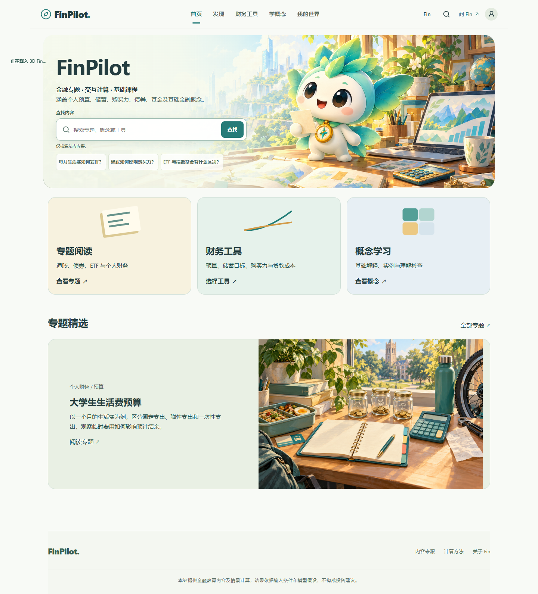
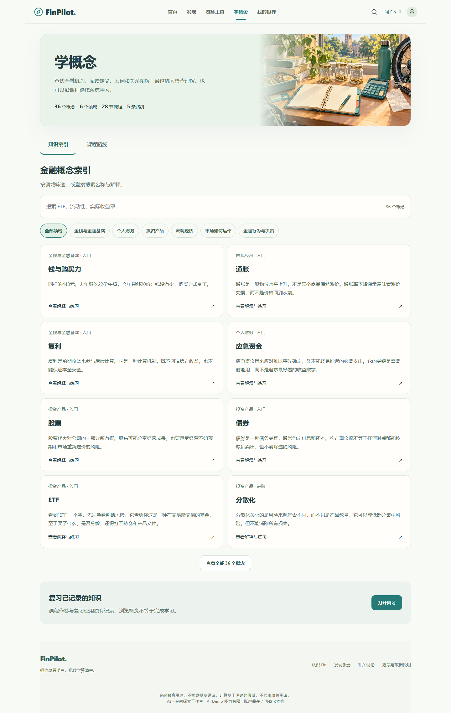
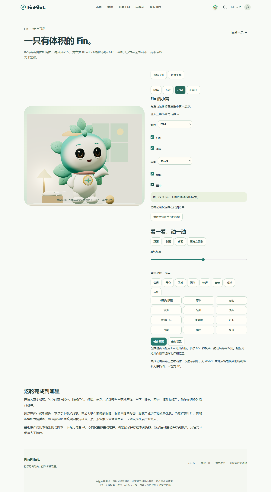

# FinPilot V3

**面向大学生与金融初学者的金融学习与实验平台。** 从一个生活问题开始，阅读专题、理解概念、调整模型参数，并保存自己的笔记与实验结果。

FinPilot is a bilingual-documented financial education project: interactive articles, deterministic financial tools, a connected concept library, personal learning records, and a local-rule-based 3D companion. [English guide](docs/README.en.md).

**发布版本：v3.0.0。** 生产目标为 [finpilot.cn](https://finpilot.cn)，部署状态以 [生产状态记录](docs/deployment/PRODUCTION_STATUS.md) 为准；请勿把目标地址视为已经完成上线的证明。



## 实际功能

| 空间 | 可以做什么 |
|---|---|
| Home | 查找站内问题、进入专题/工具/概念、继续已有任务 |
| Discover | 阅读预算、购买力、债券、ETF、贷款五个互动专题，查看文章与 FinTalk |
| Money Lab | 储蓄、复利、通胀、贷款成本和预算五套真实计算工具；参数校验、A/B 对比、保存恢复；保留八个教学实验 |
| Concept Studio | 六大领域、36 个概念、28 节课程、64 道题和五条路线；概念微实验、ETF 分类矩阵、笔记及正式复习 |
| My World | 搜索、预览、重命名、删除和重新打开学习记录、实验小票、笔记与收藏 |
| Fin Pet | 真实 3D 角色、常驻互动、120 条规则脚本、主动心情、静陪、计时、小窝、配饰、玩具与主动纪念册 |

访客记录仅存于当前浏览器；登录用户可以保存到账户。即时练习不自动等于正式复习记录，浏览也不等于掌握。没有配置模型服务时，FinChat 使用明确标识的 Demo 能力；宠物基础功能无需付费 AI。

| 财务工具 | 学概念 |
|---|---|
|  |  |



## 技术架构

- React 19、TypeScript、Vite 6；React Router、Recharts。
- FastAPI、SQLAlchemy、Pydantic；SQLite WAL 持久化。
- Three.js / React Three Fiber 按需加载 GLB；Blender 源工程独立归档。
- 金融计算在确定性后端模型中执行，不交给 LLM 计算。
- 生产：Caddy 提供静态构建、HTTPS 与 `/api/` 反向代理；systemd 运行单 worker FastAPI。2GB 服务器不承担 Node 构建。

```text
backend/app/             API、计算、账户、内容初始化和数据模型
backend/tests/           后端数学、权限、保存与兼容性测试
content/                 可重建的课程、概念、专题和题目数据
frontend/src/redesign/   当前 V3 页面与兼容入口
frontend/src/fin-pet/    宠物状态、脚本、小窝、交互与渲染
frontend/public/         正式插画、字体和 fin-3d/fin-full.glb
scripts/                Windows 本地环境、检查、发布与资产工具
deploy/production/      香港生产 Caddy、systemd、备份与激活脚本
docs/                   产品、计算口径、设计、使用与部署文档
```

带有 v2/旧名称的代码若仍被课程或兼容路由引用，继续保留。历次生成截图不属于运行依赖；精选真实截图位于 `docs/product/screenshots`，历史证据保留在 Git 历史与审查包中。

## 环境要求

已验证开发环境：Windows、Node.js **24.18.0**、Python **3.13.2**。建议使用 Node 24 LTS、Python 3.13；安装器最低检查为 Node 20、Python 3.10，但其他组合必须自行跑完整测试。生产 Ubuntu 版本须经实际 SSH 核实，不在文档中猜测。

依赖以 `frontend/package-lock.json` 和 `backend/requirements.lock.txt` 锁定。

### Windows 首次运行

```powershell
git clone https://github.com/zxy6688/FinPilot.git
cd FinPilot
powershell -NoProfile -ExecutionPolicy Bypass -File scripts/Setup-FinPilot.ps1
powershell -NoProfile -ExecutionPolicy Bypass -File scripts/Start-FinPilot.ps1
```

默认前端 `http://127.0.0.1:5176/`，后端 `http://127.0.0.1:8004/api/health`。启动脚本记录 PID、日志和实际健康状态。停止本项目服务：

```powershell
powershell -NoProfile -ExecutionPolicy Bypass -File scripts/Stop-FinPilot.ps1
```

本地脚本显式启用共享 Demo：`demo@finpilot.app` / `demo123456`；**生产禁用此账户，请注册独立账户**。不要在共享 Demo 中保存私人资料。

### 手动运行（Linux/macOS）

```bash
python3 -m venv .venv
. .venv/bin/activate
pip install -r backend/requirements.lock.txt
mkdir -p data logs tmp
cp .env.example .env
PYTHONPATH=backend python -m app.seed
PYTHONPATH=backend uvicorn app.main:app --host 127.0.0.1 --port 8004
# 在第二个终端执行
cd frontend
npm ci
npm run dev
```

`app.seed` 采用版本化增量初始化，不应通过删除数据库“更新”生产内容。

## 环境变量

见 [.env.example](.env.example)。开发可使用本地自动生成的 JWT 密钥；生产必须显式提供至少 32 字符的随机 `JWT_SECRET`，未设置时拒绝启动。

```dotenv
DATABASE_URL=sqlite:///data/finpilot.db
JWT_SECRET=
FINPILOT_ALLOW_SHARED_DEMO=false
CORS_ORIGINS=http://localhost:5176,http://127.0.0.1:5176
LLM_API_KEY=
LLM_MODEL=
LLM_BASE_URL=https://api.openai.com/v1
```

不得提交 `.env`、SQLite 用户库、密钥、访问令牌或云凭据。

## 测试与构建

```powershell
powershell -NoProfile -ExecutionPolicy Bypass -File scripts/Check.ps1
node scripts/test-pet-director.mjs
node scripts/test-fin-scripts.mjs
```

或分别执行：

```bash
python -m pytest backend/tests -q
cd frontend
npm ci
npm run typecheck
npm run build
```

浏览器检查脚本 `scripts/check-fin-full.mjs`、`scripts/check-fin-full-account.mjs` 使用本地 Chrome 和运行中的网站，账户测试创建专用测试账户。测试结果及范围见 [发布验证](docs/release/VALIDATION.md)，不将模拟手机测试写成真机验证。

## 生产部署与以后更新

目标：腾讯云 Lighthouse 香港 `43.161.236.93`；Caddy 统一 `finpilot.cn` / `www.finpilot.cn` 的 HTTPS，后端仅监听本机。代码在 `/opt/finpilot/releases/<SHA>`，数据库在 `/var/lib/finpilot`，密钥在 `/etc/finpilot/production.env`，备份在 `/var/backups/finpilot`。

[生产操作说明](docs/deployment/PRODUCTION.md)：本地修改 → 测试 → GitHub main → **人工批准** → 上传本地构建产物并切换发布目录。推送不会自动部署。

Windows 双击 `Release-Production.cmd` 只检查和打包。部署需显式执行 `Release-Production.ps1 -Mode Deploy -ApproveProduction`；回滚指定已部署 SHA，只切换程序版本，不自动倒退数据库。

账号密码使用 scrypt 哈希；JWT 需保护并定期轮换。备份使用 SQLite 在线 backup API，并检查完整性；恢复演练只写新临时目录。单机备份不能替代异地灾备，应定期将备份安全复制到独立位置。

## Fin 的真实完成范围

宠物工程已接入跨页状态、脚本节制、心情自选、计时、小窝、配饰、玩具、纪念册和账户保存。课程/正式练习/计算/保存反馈来自真实操作；不根据财务金额推断情绪。

**角色仍为程序化美术候选，不是专业美术终稿。** 眼睑、肩部、叶片和服饰贴合需要专业修型；玩具运动不是刚体物理，手机实测尚不包含真机温度和功耗。关闭网页后不会作为桌面宠物或后台计时器运行。

[美术资产保存与重建](docs/release/ASSETS.md)；完整源工程与录屏按版本发布为独立资产，运行所需 GLB 保留在源码仓库。

## 历史、后续方向与许可

- V1：保留于 `backup/main-before-v3-20261110`。
- V2：保留于 `v2`，不删除历史。
- V3 / v3.0.0：知识中心、财务工具、学习记录与 Fin Pet 整合。
- 后续：专业角色修型、真机性能验证、内容校核与生产运行观察。

FinPilot 用于金融教育和模型实验，**不是个性化投资建议，也不推荐具体借贷或投资产品**。计算结果依赖所列假设，不代表未来收益或实际融资报价。

仓库没有在此声明新增开源许可证；使用和再分发前请核对仓库现有权利说明与第三方依赖许可，不因仓库公开就推定任意授权。
