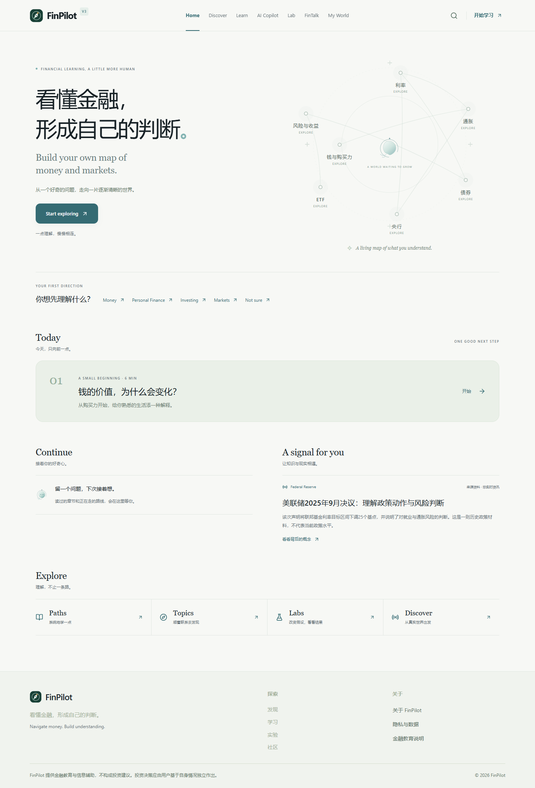
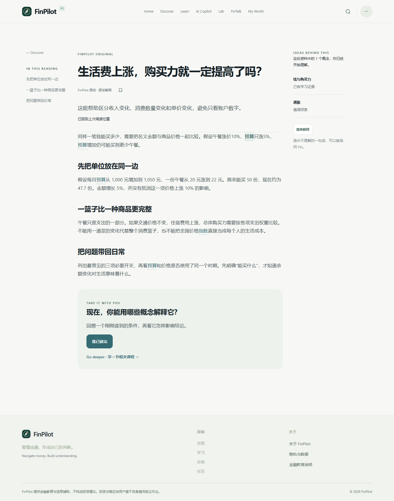
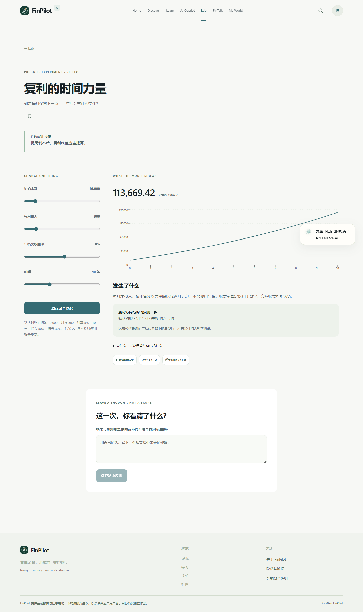
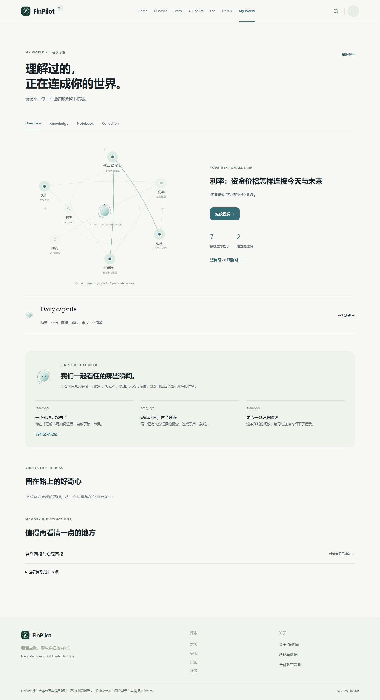
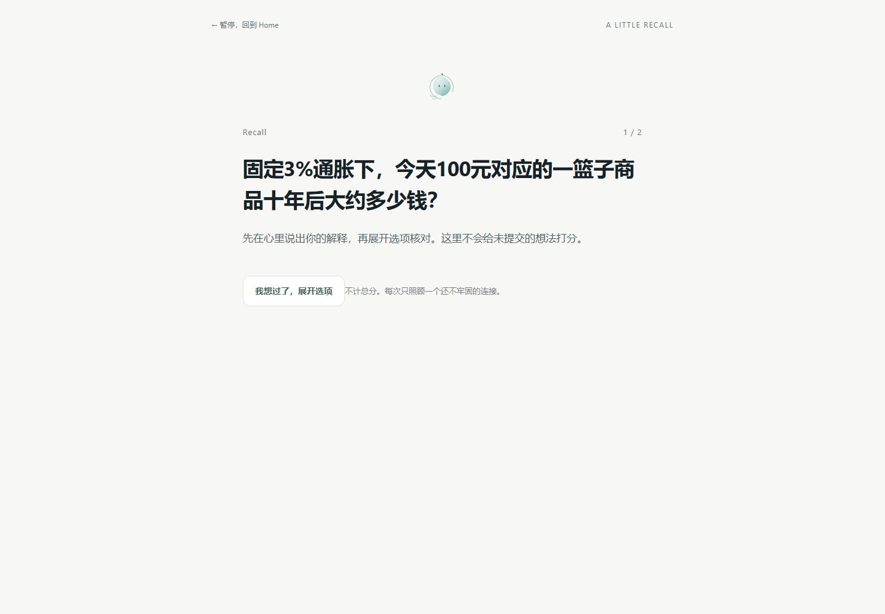

# FinPilot V3 — Living Knowledge System

Navigate money. Build understanding.

看懂金融，形成自己的判断。

V3 是一个面向大学生与金融初学者的金融理解空间。读到的概念、重新想清的问题、走过的路线和写下的实验反思，会慢慢连成自己的知识星图。Fin 是陪伴这一过程的小小向导；它的变化来自真实学习记录。

**本分支只完成本地开发与验收：NOT DEPLOYED。** [main / V1](https://github.com/zxy6688/FinPilot/tree/main) 与 [v2 / V2](https://github.com/zxy6688/FinPilot/tree/v2) 保持独立；V3 从 `a3fa070a55a4d4efd0fa47e8e835e0da6e0581c2` 创建。



## A living place to understand

- **Living Knowledge / Constellation**：24 个真实主题、32 条目录关系。Explore 展示公共知识；My World 展示自己的学习状态。两端都有充分证据，连接才会点亮。
- **Article Reader**：16 篇原创解释与 12 份真实资料导读。阅读位置可恢复，概念可点开，选中文字可就地问 Fin。
- **Smart Review / Compare**：每次 2–4 个小问题，按实际回答安排下次出现。四组概念比较帮助区分相近的词；重复混淆后，经比较和后续正确复习，才确认已厘清。
- **Learning Routes**：沿现有知识关系建立 3–7 步路线，保存进度。阅读、比较、实验和检查都要有对应记录。
- **Prediction Lab**：八个原有教学模型，先留下预测，再改变假设、观察结果、写下反思。Notebook 保存自己的原话和模型结果。
- **My World / Fin**：Overview、Knowledge、Notebook、Collection。Fin 的五种状态、领域细节和十二类记忆都有实际事件来源，没有积分、金币或排行榜。
- **Contextual AI**：文章、课程、主题、关系、路线、实验、比较和复习中均可提问。默认短答，支持深入解释；打开完整 Copilot 时接续同一会话。没有外部模型配置也能使用 Demo AI。

| Reading | Prediction Lab |
| --- | --- |
|  |  |

| My World | Focused Review |
| --- | --- |
|  |  |

截图来自实际本地页面。体验账户由验收脚本创建，学习记录通过产品 API / 页面产生；截图不代表真实用户或研究结果。[全部 V3 截图](docs/V3_SCREENSHOTS.md)。

## Run locally

技术栈保持克制：React 19、TypeScript、Vite、FastAPI、SQLAlchemy、SQLite；使用现有 Recharts、Lucide 与 SVG，没有新增大型 UI 或图网络依赖。

Windows：安装 Python 3.11+、Node.js 20+，在仓库根目录执行：

```powershell
powershell -NoProfile -ExecutionPolicy Bypass -File scripts/Setup-FinPilot.ps1
powershell -NoProfile -ExecutionPolicy Bypass -File scripts/Start-FinPilot.ps1
```

V3 前端为 `http://127.0.0.1:5176`，API 为 `http://127.0.0.1:8004`。SQLite 使用本工作区 `data/finpilot.db`；它不会和另一 worktree 共用数据库。启动器遇到其他程序占用端口会报错，不会停止其他程序。

```powershell
powershell -NoProfile -ExecutionPolicy Bypass -File scripts/Stop-FinPilot.ps1
```

停止器只处理本工作区登记且创建时间相符的进程。不要用进程名称批量结束 Node/Python。

演示登录：`demo@finpilot.app` / `demo123456`。新账户从空白记录开始。也可以直接注册自己的本地账户。

其他平台的手动开发启动：

```bash
python -m venv .venv
source .venv/bin/activate
pip install -r backend/requirements.txt
npm ci --prefix frontend
PYTHONPATH=backend python -m uvicorn app.main:app --host 127.0.0.1 --port 8004
# 另开一个终端
npm run dev --prefix frontend
```

`.env.example` 是配置模板。默认 Demo AI 不需要密钥；外部模型可选配置 `LLM_API_KEY`、`LLM_MODEL`、`LLM_BASE_URL`，仅由后端读取。API 密钥、数据库和本地 JWT secret 不进入 Git。

## Verification

```powershell
.\.venv\Scripts\python.exe -m pytest backend/tests -q
.\.venv\Scripts\python.exe -X utf8 scripts/v3-api-check.py
npm run typecheck --prefix frontend
npm run build --prefix frontend
# 启动本地服务后，使用已安装的 Chrome
node scripts/v3-gate-a-check.mjs
node scripts/v3-gate-b-check.mjs
node scripts/v3-gate-c-check.mjs
node scripts/v3-journey-check.mjs
node scripts/v3-mobile-check.mjs
node scripts/v3-interaction-check.mjs
```

浏览器脚本默认 Chrome 路径为 Windows 的标准安装目录。测试用数据库在 `tmp/`，不会重置日常运行数据库；浏览器验收会在本地运行数据库中新建示例账户。

[产品与用户闭环](docs/V3_PRODUCT.md) · [设计系统](docs/V3_DESIGN_SYSTEM.md) · [架构与 API](docs/V3_ARCHITECTURE.md) · [验收结果与边界](docs/V3_ACCEPTANCE.md)

## Scope and boundaries

FinPilot 提供金融教育与信息辅助，不构成投资建议。学习证据不评估投资能力。真实资料是有来源的固定目录，历史决议不是当前政策或实时新闻；原创解释不是来源全文转载。

Review 是明确规则驱动的短复习；Recall 先尝试回想，再用选项核对，不做自由文本语义评分。外部 AI 的实际效果依赖配置的模型服务，当前交付不声称已验证真实外部模型调用。实验使用教学假设，不预测真实收益。

本轮没有服务器部署或正式切换。仓库中既有 `deploy/` 文件保留为历史方案，未为 V3 执行或验证；不要把它们当作本轮上线步骤。
