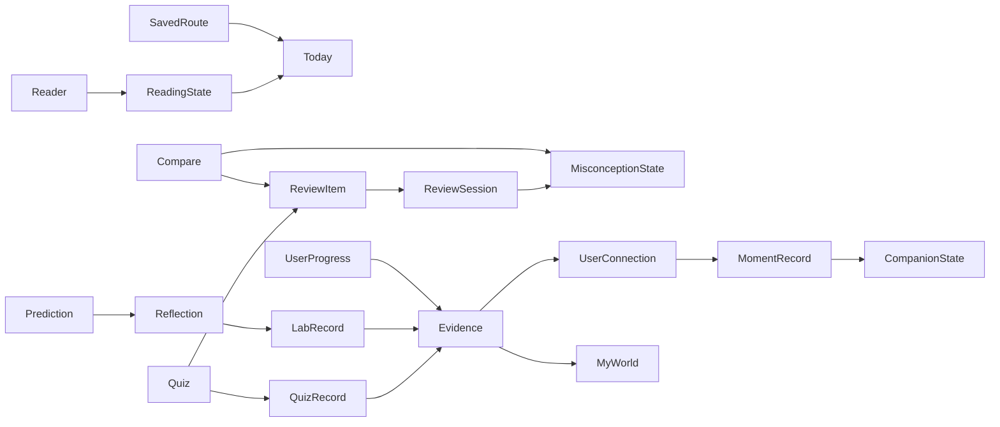

# V3 Architecture

## 延续的边界

一个 React/Vite 前端，一个 FastAPI 应用，一个本工作区 SQLite 数据库。V3 worktree 的本地端口为 5176 / 8004。没有微服务、消息队列、新图计算依赖或远程部署操作。

V1/V2 API 继续存在。Evidence 权重、正确性判断、最近活动、真实关系 BFS 与 `services/labs.py` 的八个公式不重写。V3 在既有 Quiz / Progress 写入流程旁加入记忆事件；旧表、旧字段和既有课程记录继续可用。

## Services

| 模块 | 职责 |
| --- | --- |
| `services/v3/living.py` | Home / Constellation / Companion read models，复用 V2 Evidence 和 relevance |
| `services/v3/today.py` | 有效未完成阅读 / 路线、到期复习与当日 Capsule 状态 |
| `services/v3/reading.py` | Article Reader、ReadingState、读完真实资料事件 |
| `services/v3/editorial.py` | 16 篇原创解释的正文段落 |
| `services/v3/comparisons.py` | 4 组编辑比较、正确答案、真实支持的错误选项标签 |
| `services/v3/review.py` | 固定间隔调度、2–4 项持久化会话、去重回答、QuizRecord 回写 |
| `services/v3/misconceptions.py` | suspected → observed → addressed → resolved；错误重新打开状态 |
| `services/v3/route_progress.py` | 既有 BFS 的动作快照、真实记录校验、保存与继续 |
| `services/v3/reflections.py` | 预测、原模型计算、基线对照、反思和 LabRecord 幂等保存 |
| `services/v3/transactions.py` | SQLite read-then-write 转换前获取写锁，保护多标签页的 cursor、创建与展示限额 |
| `services/v3/moments.py` | 12 类事件、真实连接、CompanionState、展示领取与会话限额 |
| `ai/living.py` | Compare / 私有 Review 上下文；复用既有模型调用入口 |
| `ai/contextual.py` | 原有六类上下文、短答、深入解释、最小必要素材 |

## Additive models

`models.py` 在定义旧表后注册 `models_v3.py`，因此应用启动与 seed CLI 都能创建新表。现有 seed 的内容版本检查保持不变。

| 表 | 持久化内容 / 约束 |
| --- | --- |
| ReadingState | user + type + content 唯一；最大进度、当前比例位置、section、时间、完成标记 |
| ReviewItem | user + item_key 唯一；q:question / c:compare、topic、due_at、streak、attempts |
| MisconceptionState | user + tag 唯一；次数、状态、observed/addressed/resolved 时间 |
| ReviewSession | user + session_key 唯一；题目快照、cursor、反馈、完成时间；Capsule key 按北京时间日期 |
| SavedRoute | 用户目标、图与步骤快照、current_step、完成记录、状态、时间 |
| Reflection | 用户实验、预测理由、实际参数、服务端结果、默认对照、反思、完成时间 |
| UserConnection | user + 真实 relation 唯一；首次解锁时间 |
| MomentRecord | user + kind + event_key 唯一；标题、说明、级别、seen_at、展示会话 |
| CompanionState | user 主键；领域、形态、最近事件与更新时间 |

共新增 9 张表；V1/V2 的 23 张表保留。SQLite foreign keys / WAL 延续原实现。兼容性脚本以只读方式备份源数据库，在副本上创建新表并比较所有旧表记录哈希；不在源数据库上迁移。

## API surface

下列均以 `/api/v3` 为前缀。需要用户数据的接口使用既有 JWT `require_user`；按 ID 读写路线、复习、反思时统一核对 owner，不透露其他账户是否存在该记录。

| Endpoint | 方法 | 作用 |
| --- | --- | --- |
| `/home` | GET | 单 Today、最多两项继续、一份 Signal、mini world |
| `/world?mode=world\|explore` | GET | 个人 / 公共完整星图 |
| `/articles/{id}` | GET | 正文、来源、已学 / 未学概念、本人阅读状态 |
| `/reading/{article\|lesson}/{id}` | GET / POST | 恢复 / 保存阅读位置 |
| `/compare`, `/compare/{slug}` | GET | 四组比较；不提前泄露答案 |
| `/compare/{slug}/check` | POST | 判断、Review 调度与 misconception 更新 |
| `/review/start` | POST | 恢复未完会话 / 当日 Capsule 或新建短复习 |
| `/review/{id}`, `/review/{id}/answer` | GET / POST | 当前题、提交与重放反馈 |
| `/memory` | GET | 本人复习与概念混淆状态 |
| `/routes` | GET / POST | 本人列表 / 保存目标路线 |
| `/routes/{id}`, `/routes/{id}/answer` | GET / POST | 校验动作记录 / 当前检查题 |
| `/labs/{id}/prediction` | GET / POST | 恢复 / 保存先验想法 |
| `/reflections/{id}/experiment` | POST | 用 LabInput 调原模型，不信任客户端结果 |
| `/reflections/{id}/complete` | POST | 保存反思并写入原 LabRecord，一次一条 |
| `/notebook` | GET | 本人完成反思 |
| `/moments`, `/moments/claim` | GET / POST | 记忆列表 / 原子会话领取语义与显示限额 |

原 `/api/chat` 增加 compare/review source_type、expand action、brief 参数；原 search 增加 comparisons 组。原 Quiz 答案可附带重复混淆时的 Compare 提示。既有字段和接口用途保留。

## State flow and invariants

- Reading `progress` 单调增加，`position` 独立计算并允许回看；completed 是明确动作，自动滚动本身不等于答题掌握。位置按正文高度比例恢复，屏幕变化时为近似同一区域。
- Review 返回当前题时隐藏 correct/explanation，提交后才给反馈。旧 cursor 重放返回已保存反馈，不重复调度。V3 写接口在读取 cursor / 展示限额之前获取 SQLite `BEGIN IMMEDIATE` 写锁；并发重复答题和记忆领取有专门测试。未声称完成大规模并发压测。
- Compare 的正确回答只推进 addressed；必须在时间上更晚的对应 Review 正确回答才 resolve。普通课程重答不冒充后续 Recall。
- Route 完成由服务端核对动作，前端没有任意勾选接口；生成后的图和步骤不漂移。标记阅读是用户确认行为，不是测量阅读理解的传感器。
- Connection 仅当真实关系两端均为 Evidence `established` 时首次保存。保存的线记录曾达到的学习里程碑；后来答错会进入复习，不删除已发生的历史。
- Moment 展示会话使用 JWT 的 jti；不存储原 token。唯一键去重。每次领取最多一条，major ≤1、medium ≤2；未展示记录仍能在记忆页看到。
- Home 会幂等识别已有课程 / 关系证据，补充 V3 派生状态，并检查活动路线。它不会往原课程、测验或实验表伪造数据。

## Frontend state

`living/` 中是 V3 页面与共享 Fin / Constellation / ReadingTools。`useReading` 先读取服务端状态再监听滚动，800ms 防抖、离页 keepalive。正文状态提示预留高度，避免保存文本出现后改变滚动锚点。选区最长 1200 字；Glossary 共享一次主题请求，用 portal 避免在正文段落中嵌套块布局。

Review 隐藏主导航。Route/Review URL 携带持久化 session/route ID，刷新可回到同一个记录。ContextAI 的完整 Copilot 链接携带 session ID；Copilot 校验并加载这个会话，在同一 context 下追问。

## AI and privacy

Demo 是确定性的站内素材解释，不是外部模型生成。External 仍通过原 provider，密钥只在后端；失败回退有明确标记。外部调用只使用当前素材、必要的主题证据和有限会话历史，不发送整份用户数据库。Review context 按 owner 读取，未答题时不发送隐藏答案。选中文字视为不可信素材，不能作为系统指令。

当前交付没有真实 External key 调用验收，没有实时新闻抓取，没有自由文本语义评分。API 和浏览器验证使用 Demo；原 provider 的 mock/fallback 回归继续保留。
