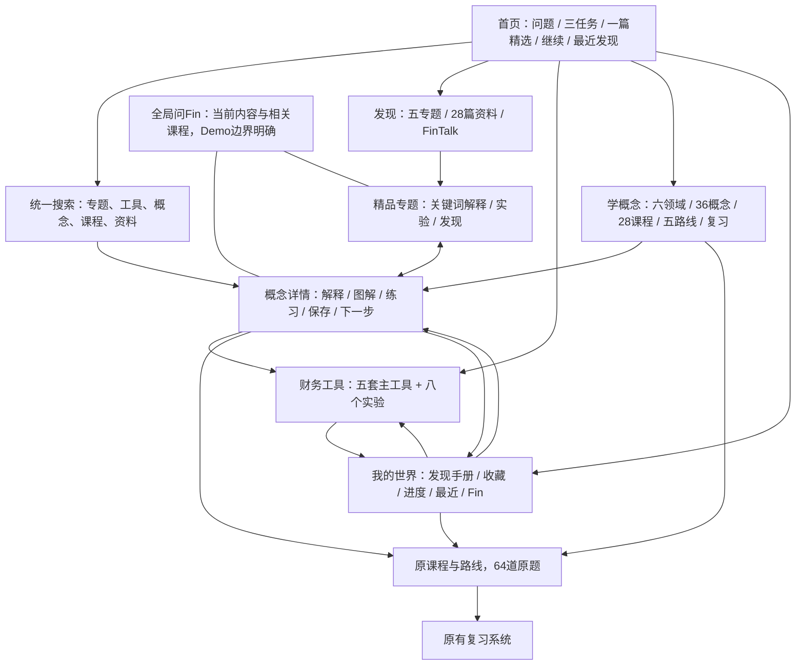

# Gate B-K 全站结构（实际实现）

|页面|实际入口|职责与后续|
|---|---|---|
|首页|/|找到问题；原主视觉不换。精选收敛为一篇预算专题，其余五专题在发现。|
|发现|/discover|五专题、资料库与 FinTalk；非实时新闻。|
|学习中心|/concept-studio|六领域；默认六个入门概念，按领域或展开完整36项；课程路线可从首屏直达。|
|概念详情|/concept-studio/:id|知识解释、例子、误区、图解、理解检查、保存笔记；相关专题、课程及下一步。|
|ETF旧课堂|/concept-studio/etf-matrix|原矩阵与正式练习完整保留，由ETF概念进入。|
|财务工具|/money-lab|五套主工具，底部清楚列出八个原实验。|
|我的世界|/profile|概念/专题/小票、重命名/删除、原收藏、继续学习、复习、旧反思与Fin纪念物。|
|课程|/lessons/:id|原课程与原题；共享学概念返回导航，保留原完成语义。|
|路线|/learn/:id、/learn/routes/:id|保留原固定与动态路线，学习中心与继续学习均可到达。|
|复习|/review|原错题与间隔复习系统；即时题不冒充已加入。|
|旧入口兼容|/learn、/knowledge、/topics、/topics/:id、/lab|目录进入新中心/工具；原24 Topic精确进入相应概念。|

六领域从首页点“学概念”再点领域，共两次主要点击。不是两个独立学习系统：新中心共享旧课程、路线、题目及账号数据。
